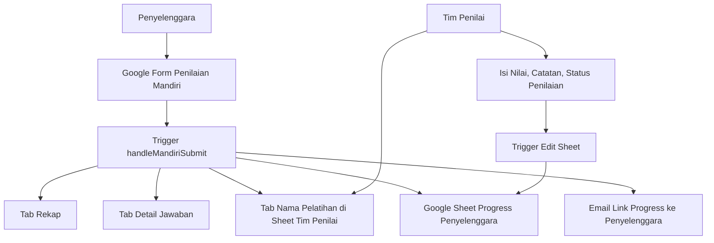

# Panduan Operasional Sistem Instrumen Penjaminan Mutu Pelatihan

Dokumen ini menjelaskan alur kerja terbaru sistem otomatisasi Instrumen Penjaminan Mutu Pelatihan. Sistem menggunakan satu Google Form untuk penilaian mandiri penyelenggara, satu Google Sheet utama untuk tim penilai, dan Google Sheet progress terpisah untuk penyelenggara.

## 1. Ringkasan Sistem

Sistem terdiri dari komponen berikut:

- **Google Form Penilaian Mandiri**: diisi oleh penyelenggara.
- **Google Sheet Tim Penilai**: pusat rekap, audit, dan penilaian.
- **Google Sheet Progress Penyelenggara**: dibuat otomatis per pelatihan agar penyelenggara dapat memantau status setiap indikator.
- **Google Apps Script**: memproses response form, membuat tab, membuat sheet progress, mengirim email, dan menyinkronkan status.

Setiap submit atau edit response akan menjalankan `handleMandiriSubmit`.



## 2. Alur Kerja Penyelenggara

1. Penyelenggara membuka Google Form.
2. Penyelenggara mengisi identitas pelatihan.
3. Penyelenggara mengisi nilai mandiri untuk 54 indikator.
4. Penyelenggara melampirkan bukti melalui salah satu cara:
   - mengisi `Lampirkan Link Dokumen`;
   - mengunggah file pada pertanyaan `Upload File`.
5. Penyelenggara mengisi `Keterangan` bila perlu.
6. Setelah submit, sistem mengirim email berisi link Google Sheet progress.
7. Link email langsung membuka tab `Progress Indikator`.

Jika penyelenggara melakukan edit response, sistem akan memperbarui data yang sama dan mengirim ulang link progress.

## 3. Alur Kerja Tim Penilai

1. Tim penilai membuka Google Sheet utama.
2. Buka tab sesuai nama pelatihan.
3. Periksa `Nilai Mandiri`, `Link Dokumen`, `Upload File`, dan `Keterangan Penyelenggara`.
4. Isi kolom:
   - `Nilai Tim Penilai`;
   - `Catatan Tim Penilai`;
   - `Status Penilaian`.
5. Status penilaian otomatis tersinkron ke sheet progress penyelenggara.

Kolom `Status Penilaian` menggunakan dropdown agar tidak ada variasi penulisan manual.

Status yang tersedia:

- `Belum Dinilai`
- `Sudah Sesuai`
- `Perlu Tindak Lanjut`

Warna status:

- kuning: `Belum Dinilai`
- hijau: `Sudah Sesuai`
- orange: `Perlu Tindak Lanjut`

## 4. Struktur Google Sheet Utama

### 4.1 Tab `Rekap`

Tab `Rekap` adalah ringkasan lintas pelatihan. Satu baris mewakili satu pelatihan.

| Kolom | Penjelasan |
| --- | --- |
| `ID Pelatihan` | ID unik otomatis dari nama pelatihan yang dinormalisasi. |
| `Nama Pelatihan` | Nama asli sesuai isian form. |
| `Nama Pelatihan Normalisasi` | Nama yang sudah dibersihkan untuk membantu deteksi duplikasi. |
| `Metode` | Metode pelatihan: daring, luring, atau blended. |
| `Tanggal Mulai` | Tanggal mulai pelatihan. |
| `Tanggal Selesai` | Tanggal selesai pelatihan. |
| `Tempat` | Lokasi penyelenggaraan. |
| `Unit Penyelenggara` | Unit atau tim penyelenggara. |
| `Tanggal Penjaminan Mutu` | Tanggal kegiatan penjaminan mutu. |
| `Status Validasi` | Status penerimaan data, misalnya `OK`, `PERLU CEK`, atau `DUPLIKAT` jika logika validasi dikembangkan. |
| `Status Penilaian` | Status umum penilaian pelatihan. Default `Belum Dinilai`. |
| `Jumlah Indikator` | Total indikator, saat ini 54. |
| `Jumlah Terisi` | Jumlah indikator yang nilai mandirinya sudah diisi. |
| `Jumlah Tidak Terisi` | Jumlah indikator yang nilai mandirinya masih kosong. |
| `Jumlah Tidak Berlaku` | Jumlah indikator dengan nilai `-`. |
| `Jumlah Bukti Link` | Jumlah indikator yang memiliki link dokumen. |
| `Jumlah Bukti File` | Jumlah indikator yang memiliki file upload. |
| `Jumlah Catatan` | Jumlah indikator yang memiliki keterangan penyelenggara. |
| `Terakhir Diubah` | Timestamp pemrosesan response terakhir. |
| `Nama Tab Detail` | Nama tab kerja pelatihan di sheet utama. |

Catatan: kolom `Persentase Capaian` dan `Kategori Mutu` sudah tidak digunakan agar rekap lebih sederhana.

### 4.2 Tab `Detail Jawaban`

Tab ini menyimpan data long-table. Satu baris mewakili satu indikator untuk satu pelatihan.

Kolom utama:

- `ID Pelatihan`
- `Nama Pelatihan`
- `Kode Indikator`
- `No`
- `Dimensi`
- `Indikator`
- `Skala`
- `Nilai Mandiri`
- `Link Dokumen`
- `Upload File`
- `Keterangan Penyelenggara`
- `Nilai Penilai`
- `Catatan Penilai`
- `Nilai Akhir`
- `Status Indikator`

Gunakan tab ini untuk filter, audit, pivot, atau analisis detail indikator.

### 4.3 Tab Nama Pelatihan

Tab ini dibuat otomatis berdasarkan `Nama Pelatihan`. Ini adalah ruang kerja utama tim penilai.

Kolom penting:

- `Nilai Mandiri`: nilai dari penyelenggara.
- `Link Dokumen`: bukti berupa URL.
- `Upload File`: link file Google Drive dari upload form.
- `Keterangan Penyelenggara`: catatan dari penyelenggara.
- `Nilai Tim Penilai`: nilai hasil pemeriksaan tim.
- `Catatan Tim Penilai`: catatan koreksi atau klarifikasi.
- `Status Penilaian`: dropdown status indikator.
- `Nilai Akhir`: memakai nilai tim penilai jika ada; jika belum ada, memakai nilai mandiri.

Jika penyelenggara mengedit response, sistem membangun ulang tab ini tetapi tetap mempertahankan `Nilai Tim Penilai`, `Catatan Tim Penilai`, dan `Status Penilaian` yang sudah diisi.

### 4.4 Tab `Dashboard`

Tab dashboard berisi agregat sederhana:

- total pelatihan;
- jumlah pelatihan sudah/belum dinilai;
- total indikator;
- total indikator terisi;
- total indikator tidak terisi;
- total indikator tidak berlaku;
- total bukti link;
- total bukti file;
- total catatan.

## 5. Sheet Progress Penyelenggara

Sistem membuat Google Sheets baru per pelatihan untuk penyelenggara. Sheet ini berbeda dari sheet tim penilai.

Nama file:

```text
Progress Penilaian Penyelenggara - [Nama Pelatihan]
```

Tab di dalamnya:

- `Ringkasan`
- `Progress Indikator`

### 5.1 Tab `Ringkasan`

Berisi:

- ID pelatihan;
- nama pelatihan;
- metode;
- tanggal pelatihan;
- tempat;
- unit penyelenggara;
- waktu update terakhir;
- jumlah indikator;
- jumlah sudah dinilai;
- jumlah belum dinilai;
- jumlah perlu tindak lanjut.

### 5.2 Tab `Progress Indikator`

Berisi daftar indikator dan status penilaiannya.

Kolom utama:

- `Kode Indikator`
- `No`
- `Dimensi`
- `Indikator`
- `Nilai Mandiri`
- `Ada Link Dokumen`
- `Ada File Upload`
- `Keterangan Penyelenggara`
- `Status Penilaian`
- `Catatan Tim Penilai`
- `Terakhir Diperbarui`

Link yang dikirim via email langsung membuka tab `Progress Indikator`, bukan tab kosong `Sheet1`.

## 6. Struktur Google Form

### 6.1 Identitas Pelatihan

Isian identitas:

- `Nama Pelatihan`
- `Metode`
- `Tanggal Mulai Pelatihan`
- `Tanggal Selesai Pelatihan`
- `Tempat Penyelenggaraan`
- `Unit Penyelenggara`
- `Tanggal Kegiatan Penjaminan Mutu`

### 6.2 Indikator

Setiap indikator memiliki blok:

1. `Nilai Mandiri`
2. `Bukti Dukung` atau `Lampirkan Link Dokumen`
3. `Upload File`
4. `Keterangan`

Nilai mandiri:

- `1`: ada/terpenuhi;
- `0`: tidak ada/tidak terpenuhi;
- `-`: tidak berlaku.

Untuk bukti dukung, cukup isi salah satu:

- link dokumen; atau
- upload file.

Jika upload file digunakan, sistem mengubah ID file dari Google Forms menjadi link Drive pada kolom `Upload File`.

## 7. Daftar Dimensi dan Indikator

Instrumen terdiri dari 54 indikator dalam 7 dimensi:

| Dimensi | Rentang Indikator |
| --- | --- |
| Perencanaan Pelatihan | I001-I010 |
| Tenaga Pelatihan | I011-I014 |
| Penyelenggaraan Pelatihan | I015-I022 |
| Pemantauan dan Evaluasi | I023-I026 |
| Hasil Penyelenggaraan | I027-I031 |
| Prasarana Pelatihan | I032-I046 |
| Sarana Pelatihan | I047-I054 |

Rincian indikator dimuat di `Master Indikator` pada Google Sheet utama dan di sumber indikator yang dibaca oleh Apps Script.

## 8. Fungsi Apps Script Penting

### Fungsi utama

- `setupInstrumenPenjaminanMutu`: membuat sistem awal.
- `handleMandiriSubmit`: trigger utama submit/edit response form.
- `handlePenilaianSheetEdit`: trigger edit untuk sinkronisasi status penilaian ke sheet penyelenggara.
- `createTrainingAssessmentSheet_`: membuat atau memperbarui tab nama pelatihan.
- `syncOrganizerProgressSheet_`: membuat atau memperbarui sheet progress penyelenggara.
- `sendOrganizerProgressEmail_`: mengirim email link progress.

### Fungsi pemeliharaan

- `resyncMandiriResponsesToSummaryModel`: memproses ulang semua response lama.
- `migrateExistingRekapToSummaryModel`: membangun ulang `Rekap`, `Detail Jawaban`, dan `Dashboard`.
- `updateExistingRekapColumnsForSimpleModel`: menyederhanakan kolom `Rekap` lama.
- `installPenilaianEditTriggerForExistingSpreadsheet`: memasang trigger edit pada spreadsheet yang sudah ada.
- `applyStatusPenilaianDropdownsToExistingSheets`: memasang dropdown dan warna status pada tab lama.

## 9. Setelah Update Kode

Setelah `npx clasp push`, beberapa fungsi perlu dijalankan sekali dari Apps Script Editor untuk spreadsheet lama:

```text
installPenilaianEditTriggerForExistingSpreadsheet
applyStatusPenilaianDropdownsToExistingSheets
resyncMandiriResponsesToSummaryModel
```

Gunakan `resyncMandiriResponsesToSummaryModel` jika ingin:

- memperbarui data lama;
- membuat ulang sheet progress penyelenggara;
- mengirim ulang email link progress;
- memastikan link upload file lama masuk ke kolom `Upload File`.

## 10. Testing Browser Automation

Runner Playwright tersedia di:

```text
scripts/google-form-browser-test.js
```

Dry-run:

```powershell
npm run test:form -- --config "test-data/google-form-answers.form-data-1uHzZr.json"
```

Submit dummy:

```powershell
npm run test:form:submit -- --config "test-data/google-form-answers.form-data-1uHzZr.json" --count 10
```

Catatan:

- Google dapat menolak login dari browser otomatis.
- Jika testing tanpa login diperlukan, matikan sementara collect email terverifikasi dan hindari file upload.
- Jika file upload tetap aktif, Google Form biasanya akan meminta login.

## 11. Catatan Validasi Nama Pelatihan

Sistem membuat `ID Pelatihan` dari `Nama Pelatihan Normalisasi`. Ini membantu konsistensi dan menjadi dasar untuk validasi duplikasi.

Status validasi saat ini default `OK`. Ke depan status ini dapat dikembangkan menjadi:

- `OK`
- `PERLU CEK`
- `DUPLIKAT`
- `DITOLAK`

Untuk validasi lanjutan, pendekatan yang disarankan adalah kombinasi normalisasi teks, fuzzy matching, dan LLM hanya untuk kasus ambigu.
